  

I'm a software engineer based in the UAE with 7+ years of shipping mobile apps, backend services and cloud infrastructure. Most of my work is **Flutter** on the front and **Laravel, Node.js or Python** behind it. I run **249apps**, a small studio where I design, build and publish my own apps, many of them Arabic-first.

  
  
  

## 📱 Apps on the stores

<table>
  <tr>
    <td width="76"></td>
    <td>
      <b>Tashkeela · تشكيلة</b> — guess the football team from its lineup. Six game modes, daily challenges and global leaderboards, in Arabic and English. 
      <a href="https://apps.apple.com/us/app/tashkeela-football-quiz/id6765641224">App Store</a> · <a href="https://play.google.com/store/apps/details?id=com.z249apps.tashkeela">Google Play</a> · <a href="https://tashkeela.249apps.com">Website</a> 
      Flutter · Laravel · MySQL · Firebase
    </td>
  </tr>
  <tr>
    <td></td>
    <td>
      <b>Studiaro</b> — practice tests and mock exams for AWS, Azure, Google Cloud, Cisco, CompTIA, PMP and more, with an explanation for every answer. 
      <a href="https://apps.apple.com/us/app/studiaro-certification-prep/id6801530577">App Store</a> · <a href="https://play.google.com/store/apps/details?id=com.z249apps.studiaro">Google Play</a> · <a href="https://249apps.com/studiaro/">Website</a> 
      Flutter · Laravel · Filament · RevenueCat · OpenAI
    </td>
  </tr>
  <tr>
    <td></td>
    <td>
      <b>Talas · طلس</b> — a real-time Arabic bluffing party game. Write a convincing fake answer, then vote to find the real one. One room across iOS, Android and the web. 
      <a href="https://apps.apple.com/us/app/%D8%B7%D9%84%D8%B3/id6799531653">App Store</a> · <a href="https://play.google.com/store/apps/details?id=com.z249apps.talas">Google Play</a> · <a href="https://talas.249apps.com/site/">Website</a> 
      Flutter · Node.js · WebSockets · Laravel · Firebase
    </td>
  </tr>
  <tr>
    <td></td>
    <td>
      <b>Rooh · روح</b> — an offline-first Quran memorisation companion with spaced review, a tajweed-coloured mushaf, tafsir and recitations. 
      <a href="https://apps.apple.com/us/app/id6801590728">App Store</a> · <a href="https://play.google.com/store/apps/details?id=com.z249apps.rooh">Google Play</a> 
      Flutter · offline datasets · streamed audio
    </td>
  </tr>
  <tr>
    <td></td>
    <td>
      <b>TaskFlow</b> — checklists, Markdown notes, kanban boards, tables and timelines in one app, synced across phone, tablet and web. 
      <a href="https://apps.apple.com/us/app/taskflow-to-do-list-planner/id6807586084">App Store</a> · <a href="https://play.google.com/store/apps/details?id=com.z249apps.taskflow">Google Play</a> 
      Flutter · Firestore · RevenueCat
    </td>
  </tr>
  <tr>
    <td></td>
    <td>
      <b>Spndsy AI</b> — income, expenses and category budgets with AI insights into your spending, plus PDF, Excel and CSV export. 
      <a href="https://apps.apple.com/us/app/spndsy-ai/id6753125235">App Store</a> · <a href="https://play.google.com/store/apps/details?id=com.mhk26.spndsyAI">Google Play</a> 
      Flutter · Firebase · OpenAI
    </td>
  </tr>
  <tr>
    <td></td>
    <td>
      <b>ChatMBTI</b> — chat with AI personas of all 16 personality types, with a built-in personality quiz and Arabic replies. 
      <a href="https://apps.apple.com/us/app/chatmbti/id6757331968">App Store</a> · <a href="https://play.google.com/store/apps/details?id=com.mhk26.chatmbti">Google Play</a> 
      Flutter · OpenAI · RevenueCat
    </td>
  </tr>
  <tr>
    <td></td>
    <td>
      <b>Jahbaz · الجهبذ</b> — four Arabic word and trivia games in one: letter scramble, multiple choice, word search and connections. 
      <a href="https://play.google.com/store/apps/details?id=com.z249apps.jahbaz">Google Play</a> · <a href="https://249apps.com/jahbaz/">Website</a> 
      Flutter · Firebase · AdMob
    </td>
  </tr>
  <tr>
    <td></td>
    <td>
      <b>Silo 26</b> — native Swift apps that turn your iPhone into a trackpad and remote for your Mac, over Wi-Fi or an end-to-end encrypted relay. 
      <a href="https://control.249apps.com">Website</a> 
      Swift · SwiftUI · ScreenCaptureKit · CryptoKit
    </td>
  </tr>
  <tr>
    <td></td>
    <td>
      <b>Sidekick</b> coming soon — a weekly workout plan built from five questions, 3D exercise demos with a voice coach, and meal and macro tracking. 
      <a href="https://249apps.com/sidekick/">Website</a> 
      Flutter · PHP · Firebase · RevenueCat · HealthKit
    </td>
  </tr>
</table>

## 🌐 Web, AI and open source

<table>
  <tr>
    <td width="76"></td>
    <td>
      <b>Mokhbir · المخبر المعلوماتي</b> — an AI newsroom for tech news in plain Arabic. An agent reads YouTube, RSS, Hacker News and Reddit, drafts each story, and sends it to Telegram for a human to approve before it is published. 
      <a href="https://mokhbirtech.com">mokhbirtech.com</a> · <a href="https://www.facebook.com/mokhbirtech">Facebook</a> 
      Python · Gemini · Telegram Bot · Remotion
    </td>
  </tr>
  <tr>
    <td></td>
    <td>
      <b>zampp</b> — an open-source, secure-by-default XAMPP for macOS: Apache, PHP-FPM, MariaDB, Mailpit and Adminer with a web control panel and CLI. 
      <a href="https://github.com/MHK-26/zampp">github.com/MHK-26/zampp</a> 
      TypeScript · Node · Vite
    </td>
  </tr>
</table>

## 🧰 What I work with

| | |
|---|---|
| **Mobile** | Flutter, Dart, Swift, SwiftUI |
| **Backend** | PHP and Laravel, Node.js, Python, Java and Spring Boot |
| **Cloud and DevOps** | AWS, Google Cloud, Oracle Cloud, Docker, CI/CD |
| **Data** | MySQL, PostgreSQL, Firebase and Firestore |
| **AI** | OpenAI and Gemini APIs, agent pipelines |

## 🤝 Get in touch

Open to senior engineering roles and to build-and-scale projects. The quickest way to reach me is [LinkedIn](https://www.linkedin.com/in/mhk26).
