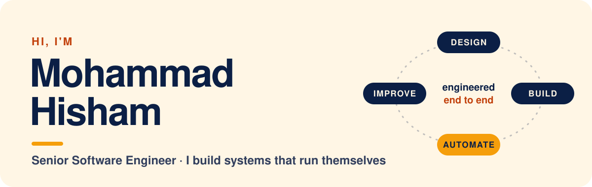
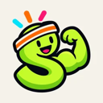

  

I'm a software engineer who **loves automation**. I design and build the pipelines, agents and tooling that take repetitive work off people's hands, so the time goes into the product. I ship mobile apps, backend services and cloud infrastructure, mostly **Flutter** on the front and **Laravel, Node.js or Python** behind it, and many of my apps are Arabic-first.

  
  
  

## 📱 Apps on the stores

<table>
  <tr>
    <td width="76"></td>
    <td>
      <b>Tashkeela · تشكيلة</b> — guess the football team from its lineup. 
      <a href="https://apps.apple.com/us/app/tashkeela-football-quiz/id6765641224">App Store</a> · <a href="https://play.google.com/store/apps/details?id=com.z249apps.tashkeela">Google Play</a> · <a href="https://tashkeela.249apps.com">Website</a>
    </td>
  </tr>
  <tr>
    <td></td>
    <td>
      <b>Studiaro</b> — practice tests and mock exams for IT certifications. 
      <a href="https://apps.apple.com/us/app/studiaro-certification-prep/id6801530577">App Store</a> · <a href="https://play.google.com/store/apps/details?id=com.z249apps.studiaro">Google Play</a> · <a href="https://249apps.com/studiaro/">Website</a>
    </td>
  </tr>
  <tr>
    <td></td>
    <td>
      <b>Talas · طلس</b> — an Arabic bluffing party game to play with friends. 
      <a href="https://apps.apple.com/us/app/%D8%B7%D9%84%D8%B3/id6799531653">App Store</a> · <a href="https://play.google.com/store/apps/details?id=com.z249apps.talas">Google Play</a> · <a href="https://talas.249apps.com/site/">Website</a>
    </td>
  </tr>
  <tr>
    <td></td>
    <td>
      <b>Rooh · روح</b> — a Quran memorisation and review companion. 
      <a href="https://apps.apple.com/us/app/id6801590728">App Store</a> · <a href="https://play.google.com/store/apps/details?id=com.z249apps.rooh">Google Play</a>
    </td>
  </tr>
  <tr>
    <td></td>
    <td>
      <b>TaskFlow</b> — notes, tasks and boards in one app. 
      <a href="https://apps.apple.com/us/app/taskflow-to-do-list-planner/id6807586084">App Store</a> · <a href="https://play.google.com/store/apps/details?id=com.z249apps.taskflow">Google Play</a>
    </td>
  </tr>
  <tr>
    <td></td>
    <td>
      <b>Spndsy AI</b> — budgets, spending and AI insights. 
      <a href="https://apps.apple.com/us/app/spndsy-ai/id6753125235">App Store</a> · <a href="https://play.google.com/store/apps/details?id=com.mhk26.spndsyAI">Google Play</a>
    </td>
  </tr>
  <tr>
    <td></td>
    <td>
      <b>ChatMBTI</b> — chat with AI personas of all 16 personality types. 
      <a href="https://apps.apple.com/us/app/chatmbti/id6757331968">App Store</a> · <a href="https://play.google.com/store/apps/details?id=com.mhk26.chatmbti">Google Play</a>
    </td>
  </tr>
  <tr>
    <td></td>
    <td>
      <b>Jahbaz · الجهبذ</b> — four Arabic word and trivia games in one. 
      <a href="https://play.google.com/store/apps/details?id=com.z249apps.jahbaz">Google Play</a> · <a href="https://249apps.com/jahbaz/">Website</a>
    </td>
  </tr>
  <tr>
    <td></td>
    <td>
      <b>Silo 26</b> — your iPhone becomes a trackpad and remote for your Mac. 
      <a href="https://control.249apps.com">Website</a>
    </td>
  </tr>
  <tr>
    <td></td>
    <td>
      <b>Sidekick</b> coming soon — a workout plan, exercise demos and a calorie counter. 
      <a href="https://249apps.com/sidekick/">Website</a>
    </td>
  </tr>
</table>

## 🌐 Web, AI and open source

<table>
  <tr>
    <td width="76"></td>
    <td>
      <b>Mokhbir · المخبر المعلوماتي</b> — tech and AI news in plain Arabic. 
      <a href="https://mokhbirtech.com">mokhbirtech.com</a> · <a href="https://www.facebook.com/mokhbirtech">Facebook</a>
    </td>
  </tr>
  <tr>
    <td></td>
    <td>
      <b>zampp</b> — an open-source, secure-by-default XAMPP for macOS. 
      <a href="https://github.com/MHK-26/zampp">github.com/MHK-26/zampp</a>
    </td>
  </tr>
</table>

## 🧰 What I work with

| | |
|---|---|
| **Mobile** | Flutter, Dart, Swift, SwiftUI |
| **Backend** | PHP and Laravel, Node.js, Python, Java and Spring Boot |
| **Cloud and DevOps** | AWS, Google Cloud, Oracle Cloud, Docker, CI/CD |
| **Data** | MySQL, PostgreSQL, Firebase and Firestore |
| **Automation** | Fastlane, GitHub Actions, Telegram bots, AI agent pipelines |
| **AI** | OpenAI and Gemini APIs |

## 🤝 Get in touch

The quickest way to reach me is [LinkedIn](https://www.linkedin.com/in/mhk26).
